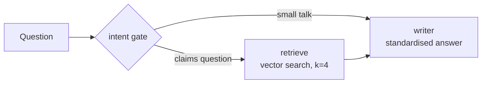

# Claims Adjustment RAG Assistant

Helps auto and property claims adjusters check cover and procedures against the company's technical manuals, with standardised, sourced answers.

**Stack:** Python · LangGraph · LangChain · Azure OpenAI · Azure AI Search · Azure Document Intelligence · Streamlit
**Role:** Lead developer: design and implementation

> Built at a large Brazilian insurer. The company is replaced by the fictional **Acme Seguros**, and every name, document and data point here is fictional. Code, prompts and UI are in Portuguese, written for Brazilian business teams.

## Problem

Adjusters handling auto and property (Auto/RE) claims had to look up cover rules and procedures in long technical manuals and email circulars. Different adjusters reached different answers for the same case.

## What I built



- **Scope guard:** the assistant only answers within the company's manuals and norms.
- **Grounding with business definitions:** the prompt carries the official definitions of each line of business to avoid mix-ups between auto and property cover.
- **Privacy in the prompt:** it never addresses the user by names found inside the retrieved manuals or emails (policyholders, managers, examples), and ignores greetings inside the context.
- **Ingestion script** for PDF and Word manuals through Document Intelligence.

## Run it

```bash
python -m venv .venv && .venv\Scripts\activate   # macOS/Linux: source .venv/bin/activate
pip install -r requirements.txt
cp .env.example .env                               # Azure OpenAI + AI Search
python ingest.py                                   # index your manuals
streamlit run agent.py
```

---
Part of my [AI engineering portfolio](https://github.com/lucasboliveirasipp).
